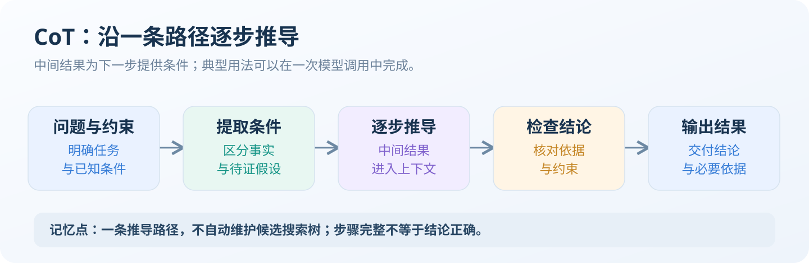
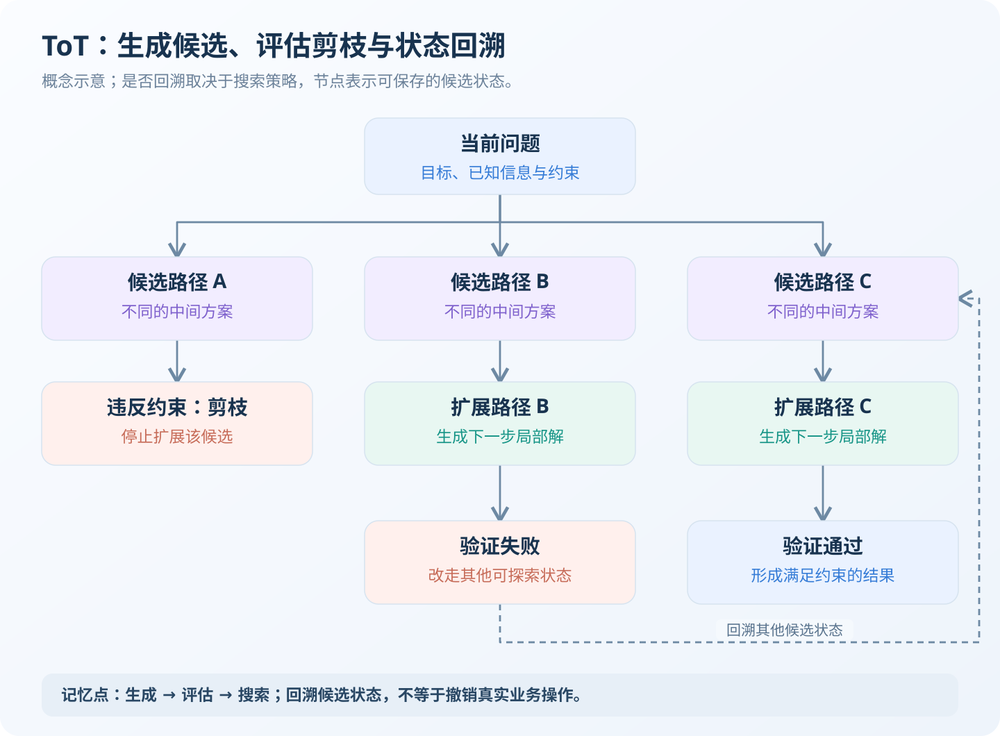
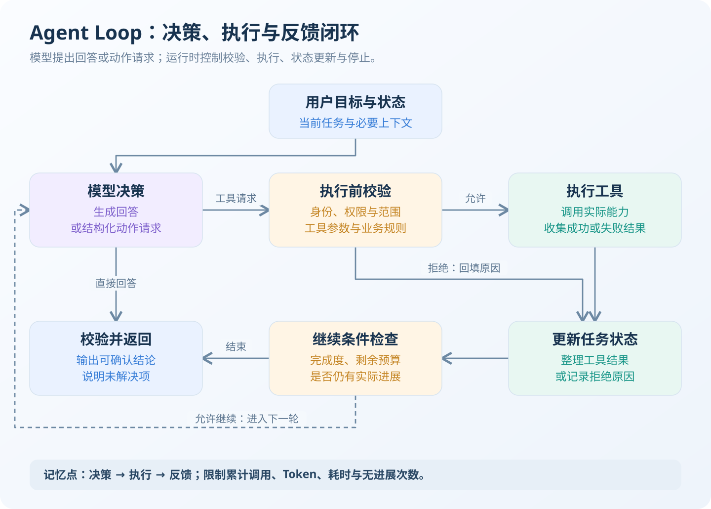

**Reasoning Model、CoT、ToT 与 Agent Loop 分别处于模型能力、提示方法、搜索策略和执行机制四个层级。** 它们可以组合使用，并不是四种互斥的技术方案。<!-- more -->

例如，代码修复智能体可以使用推理模型分析问题，通过 Agent Loop 读取源码、修改代码、执行测试；存在多种候选修复路径时，再引入 ToT 搜索。

# Reasoning Model：模型的推理能力

## 定义与工作原理

**Reasoning Model 是经过专门训练或优化，能够通过额外推理计算处理复杂问题的模型。**

这类模型通常结合推理过程学习、强化学习等技术，在生成答案前或任务执行过程中进行分析、规划和检查。具体训练路线与内部机制因模型而异，不能统一描述为某一种算法。

以使用推理 Token 的实现为例，模型会在最终答案之外消耗额外 Token，用于中间计算。这些内容不一定直接展示给用户。[推理模型机制](https://developers.openai.com/api/docs/guides/reasoning)

需要区分：

| 概念 | 含义 |
| --- | --- |
| 推理能力 | 解决多步骤、复杂约束问题的实际能力 |
| 推理预算 | 一次任务允许投入的推理计算资源 |
| 可见解释 | 返回给用户的步骤、依据或分析摘要 |

**分析文字更长，不代表推理能力更强；没有展示详细过程，也不代表没有进行推理。**

## 推理模式与混合推理

| 形态 | 特点 | 典型任务 |
| --- | --- | --- |
| 非扩展推理模式 | 不启用专门的扩展推理过程，直接生成响应 | 翻译、分类、字段提取 |
| 推理模式 | 为复杂问题投入额外推理计算 | 数学、代码调试、多约束分析 |
| 混合推理 | 同一模型支持不同模式或推理投入，部分实现可以自适应调整 | 通用助手、企业级 Agent |

**“非推理”不表示模型完全没有逻辑能力，而是没有启用专门的扩展推理机制。** 混合推理也不是统一的模型架构标准。

应用可以通过模型选择、模式切换或推理强度配置控制计算投入，但参数支持和默认行为必须按具体模型确认。

## 适用场景与局限

推理模型适合需要处理多个约束、建立依赖关系或检验假设的任务，例如跨模块调试、架构设计和复杂规划。

优势是能够为困难问题投入更多计算；代价通常是更高的 Token 消耗与响应延迟。

**推理不能替代事实和验证。** 缺少执行计划时，更多推理不能证明数据库索引失效；缺少业务数据时，也不能推导出真实库存。

# CoT：通过中间步骤组织推导

## 定义与工作原理

**CoT（Chain of Thought，思维链）通过中间步骤，将复杂问题拆解为相互衔接的推导过程。**

在提示工程中，[CoT](https://arxiv.org/abs/2201.11903)通常通过分步任务说明或带有中间步骤的示范，引导模型求解。前面生成的中间结果进入上下文，为后续生成提供条件。



典型 CoT 沿一条路径向前推进，不自动维护可供程序操作的候选搜索树。

## 简洁示例

分析接口超时时，可以组织为：

```text
分析接口超时问题，分别给出：
1. 日志能够确认的事实。
2. 尚需验证的可能原因。
3. 各原因对应的验证动作。
4. 当前可以确认的结论。

不要将相关性直接视为因果关系。
```

这种提示明确了分析结构和交付要求。对于具有专门推理能力的模型，应优先说明目标、约束和验收条件，不必机械要求输出完整思维链。[推理提示实践](https://developers.openai.com/api/docs/guides/reasoning-best-practices)

## 特点与注意事项

| 方面 | 核心要点 |
| --- | --- |
| 实现方式 | 分步说明任务，或提供必要的推导示范 |
| 适用场景 | 多步骤计算、规则判断、技术分析 |
| 优势 | 接入简单，通常可在一次调用中完成 |
| 局限 | 早期错误可能沿后续步骤传播 |
| 注意事项 | 步骤完整不等于结论正确，中间结果仍需核验 |

**CoT 是推理组织方法，不是正确性保证，也不要求多次模型调用。**

# ToT：对不同推理路径进行搜索

## 定义与工作原理

**ToT（Tree of Thoughts，思维树）将求解过程组织为候选状态的生成、评估与搜索。**

思维树是思维链的推广，它将推理过程组织为树形结构，允许在每个决策点探索多个可能的方向。

[ToT](https://arxiv.org/html/2305.10601v2)中的节点可以是一段中间推导、局部方案或部分解。系统保存多个候选状态，根据评估结果决定继续扩展、剪枝或返回其他路径。



图中回溯的是候选状态。是否实际回溯，取决于采用的搜索算法。

**ToT 的关键不只是生成多个方案，而是能够保存、评估并继续扩展中间状态。**

## 实现方式

| 组成部分 | 职责 |
| --- | --- |
| 状态表示 | 保存局部解、约束、待解决问题与父节点 |
| 候选生成器 | 提出下一步可选方向 |
| 评估器 | 判断候选是否有效、是否值得继续探索 |
| 搜索控制器 | 管理扩展顺序、剪枝、深度和预算 |

例如，代码修复可以先生成不同修改方向，再通过编译和测试筛选候选，继续修正尚未通过的方案。

候选生成与评估可以复用同一个模型，也可以结合确定性规则和工具。**ToT 不要求多个 Agent。**

## 适用条件与代价

ToT 更适合同时满足以下条件的任务：

- 存在多个有价值的候选方向。
- 早期选择会影响后续结果。
- 能够有效评估中间状态。

典型场景包括候选代码修复、多约束规划和复杂方案设计。

其主要成本来自候选生成、重复评估和搜索状态管理。评估器不可靠时，搜索可能放大错误；过早剪枝也可能丢失有效路径。

**搜索回溯不等于业务回滚。** 丢弃一个候选方案，不能自动撤销已发送的邮件或已执行的转账。

# Agent Loop：让决策与环境反馈形成闭环

## 定义与工作原理

**Agent Loop 是智能体反复执行“模型决策 → 动作执行 → 接收反馈 → 更新状态”的运行机制。**

它负责推进任务，不规定模型必须采用哪一种推理方法。



例如，代码修复 Agent 可以读取异常、定位源码、修改代码、执行测试，再根据失败结果调整修复。

**模型提出工具调用请求，运行时负责权限校验和实际执行。** 模型生成了调用参数，不代表工具已经成功执行。

## 为什么需要执行循环

工具结果通常会改变下一步决策。查询订单后才能判断是否查询物流，执行测试后才能确认修复是否有效。

但执行顺序明确的业务，没有必要全部交给模型动态规划：

| 机制 | 执行路径 | 适用任务 |
| --- | --- | --- |
| 固定工作流 | 主要由代码预先定义 | 稳定、重复、规则明确 |
| Agent Loop | 根据模型决策和反馈动态调整 | 路径不确定，需要持续获取信息 |

Agent Loop 的优势是灵活、能够利用反馈纠错；代价是状态管理、权限控制和终止判断更复杂。

## Agent Loop 与 ReAct

[ReAct](https://arxiv.org/abs/2210.03629)强调推理与行动交替进行，利用外部反馈调整后续行为。

**ReAct 可以实现为 Agent Loop，但 Agent Loop 的范围更广。** 结构化工具调用、先规划后执行和状态机驱动的循环，都不必采用相同的 ReAct 文本格式。

运行时至少需要限制模型调用次数、累计 Token、总耗时和连续无进展次数。**有循环不代表能够收敛，停止条件必须由程序明确执行。**

# 四种机制的综合对比

下表比较典型用法。“可以结合”不代表天然具备对应能力。

| 维度 | Reasoning Model | CoT | ToT | Agent Loop |
| --- | --- | --- | --- | --- |
| 核心定义 | 投入额外计算处理复杂问题的模型 | 利用中间步骤组织推导 | 搜索候选推理状态 | 通过决策与反馈持续执行 |
| 本质 | 模型能力与推理机制 | 提示方法 | 搜索策略 | 执行机制 |
| 是否属于模型能力 | 是 | 方法本身不是 | 通常由外部控制器组织 | 属于应用运行时 |
| 是否需要额外 Prompt | 不要求专门的 CoT 提示 | 提示型 CoT 通常需要引导 | 通常需要生成与评估提示 | 需要任务规则与工具说明 |
| 是否需要多次模型调用 | 不一定 | 不一定 | 通常需要 | 通常需要，可立即结束 |
| 是否支持工具调用 | 取决于模型与接口 | 可以结合 | 可以用于生成或评估 | 通常负责协调工具 |
| 是否具有分支搜索 | 不能直接推断 | 典型用法没有显式搜索 | 核心特征 | 可按需加入 |
| 是否支持回溯 | 不能由模型类别推断 | 没有显式状态回溯保证 | 取决于搜索策略 | 可设计恢复，不自动撤销副作用 |
| Token 与延迟成本 | 受模型和推理预算影响 | 中间步骤通常增加输出 | 受宽度、深度和评估次数影响 | 受轮数、上下文和工具耗时影响 |
| 典型场景 | 复杂分析、数学、调试 | 可分解的多步骤问题 | 多候选、可评估的问题 | 检索、代码操作、工具协作 |

# 何时应该使用推理模型

## 从四个维度判断

| 维度 | 判断重点 | 选型原则 |
| --- | --- | --- |
| 任务复杂度 | 约束数量、依赖深度、歧义程度 | 多步骤、多约束任务更值得评估额外推理 |
| 准确率要求 | 错误来自事实缺失、计算还是推导 | 针对错误来源选择机制 |
| 延迟要求 | 实时交互还是离线任务 | 严格时限下减少串行调用和无效推理 |
| 成本敏感度 | 调用规模、重试率、人工处理成本 | 比较单个成功任务的总成本 |

复杂度不等于输入长度。长文档摘要可能主要依赖信息筛选，一小段并发代码却可能包含复杂时序关系。

**高准确率要求不意味着必须使用推理模型。** 缺少知识应补充检索，数值计算应使用工具，业务规则应由程序校验，复杂推导才需要重点评估推理能力。

## 任务与策略推荐

以下是评测起点，不是固定规则。

| 任务 | 推理策略起点 | 配套机制 |
| --- | --- | --- |
| 翻译、分类、字段提取 | 直接生成或低推理投入 | 结构化输出、规则校验 |
| 知识库问答 | 适度推理 | RAG、证据核验 |
| 一般代码审查 | 适度推理 | 源码检索、静态检查 |
| 跨模块故障排查 | 较高推理投入 | Agent Loop、日志与测试 |
| 多约束方案设计 | 较高推理投入 | 约束校验，按需引入 ToT |
| 稳定重复流程 | 低推理或固定工作流 | 业务状态机、事务与审计 |

额外推理和多轮工具调用通常会增加响应时间，但收益不一定持续增长。选型应比较任务成功率、结果正确性、尾延迟和单个成功任务成本。

**先识别瓶颈，再增加计算。** 信息缺失、工具失败和权限不足，不能单纯通过提高推理强度解决。

# 总结

**Reasoning Model 是模型能力，CoT 是提示方法，ToT 是搜索策略，Agent Loop 是执行机制。**

| 概念 | 核心记忆点 |
| --- | --- |
| Reasoning Model | 为复杂问题投入额外推理计算，不等于必须展示详细过程 |
| CoT | 用中间步骤组织推导，通常可以单次调用完成 |
| ToT | 生成、评估和搜索候选状态，价值取决于评估质量 |
| Agent Loop | 管理决策、执行、反馈与停止，让任务持续推进 |

四者可以组合，但职责应保持清晰：**模型负责分析，提示词组织任务，搜索器管理候选路径，运行时控制执行与资源。** 最终质量仍应由事实、业务规则、工具结果和实际评测验证。
