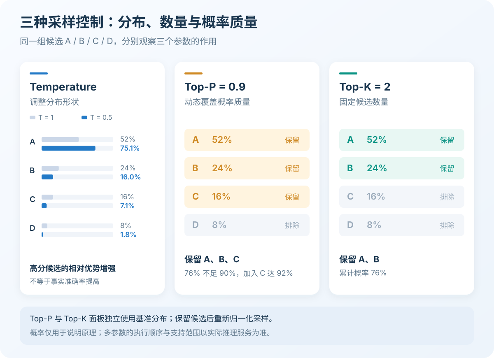
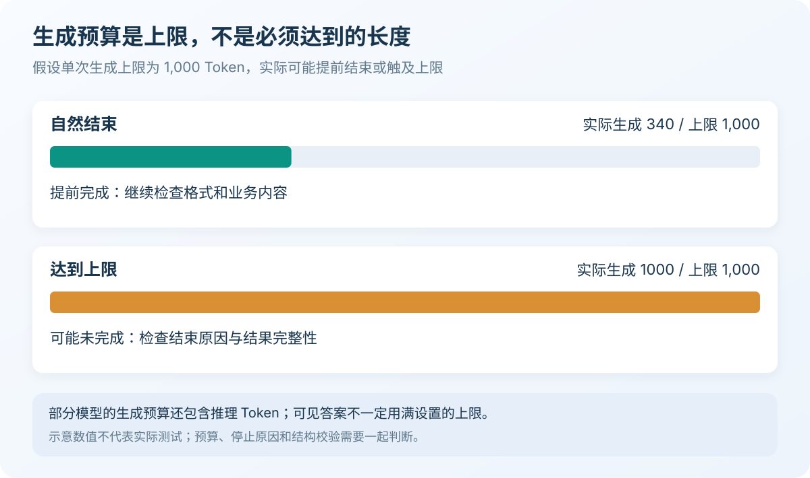
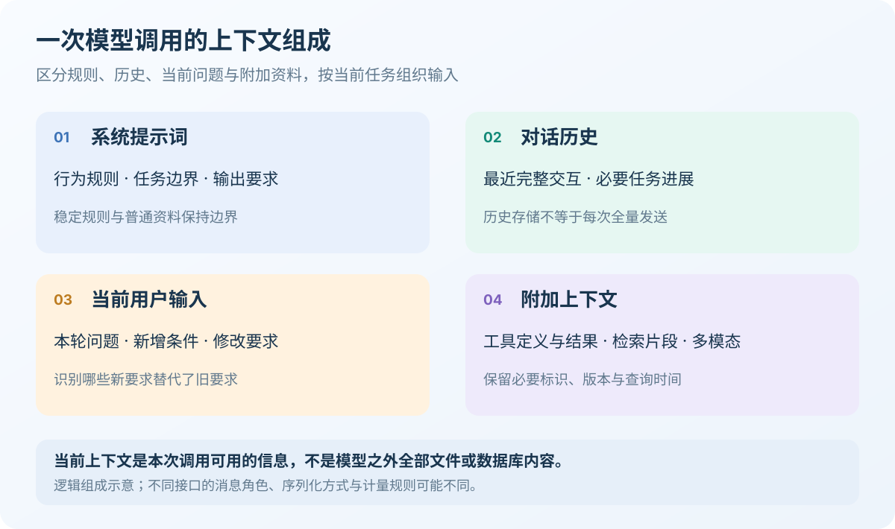
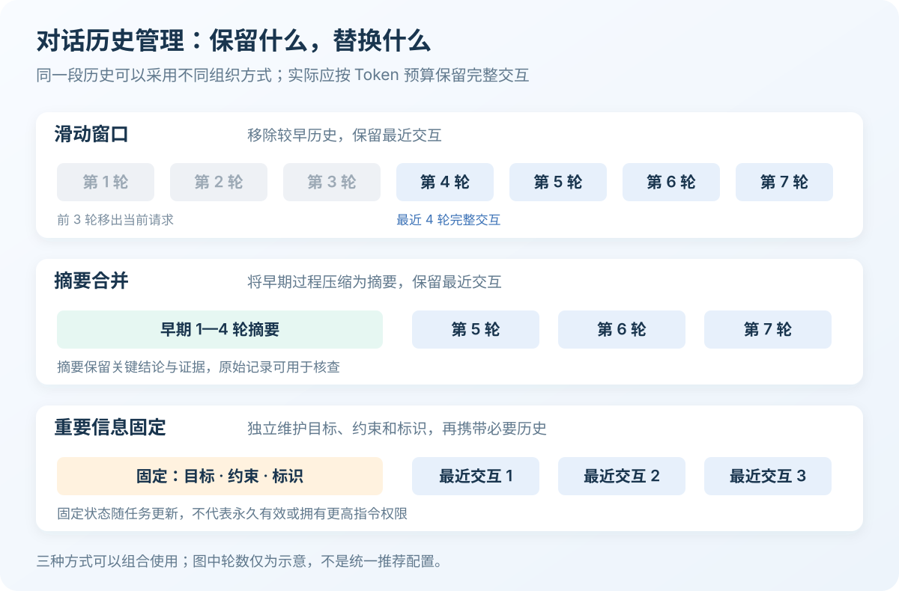
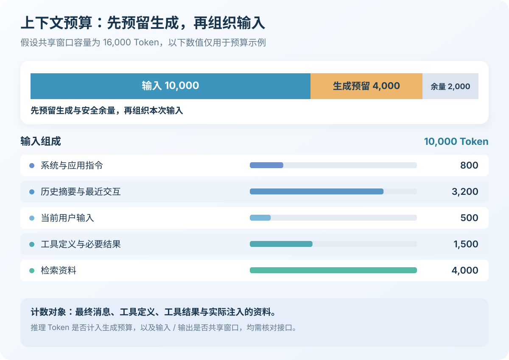

**生成参数控制模型如何输出，上下文管理决定模型能够使用哪些信息。** 前者影响随机性、长度和停止条件，后者影响证据完整性与任务连续性。优化时应同时关注回答质量、稳定性、延迟和总成本。<!-- more -->

# 模型参数与输出控制

生成参数是在推理时设置的解码配置，通常不会修改模型权重。它们能够改变输出行为，但不能补齐缺失的知识、事实或业务约束。

## Temperature（温度）

**Temperature 通过调整候选 Token 的概率分布，控制采样随机性。**

### 直观理解：保守派 vs 冒险家

| 温度设置 | 分布变化 | 通常表现 |
| --- | --- | --- |
| 低于 1、但大于 0 | 高概率候选更占优势 | 输出差异较小 |
| 等于 1 | 保持温度缩放前的分布形状 | 按基准分布采样 |
| 高于 1 | 分布趋于平缓 | 更容易选择其他候选 |

**低温度不等于高准确率，高温度也不会增加模型知识。** 缺少正确证据时，低温度可能只是让错误答案更加稳定；提高温度则主要增加表达和方案的差异。

### 核心机制：概率的“锐化”与“拉平”

模型先计算候选 Token 的分数，再通过温度缩放改变它们的相对概率。降低温度会扩大高分候选的优势，提高温度则会减弱这种差异。

`Temperature=0` 通常由服务实现为贪婪解码等特殊路径。即使不进行随机采样，数值计算、服务实现和模型版本变化仍可能影响结果，不能承诺每次逐字一致。

稳定输出还依赖输入和模型版本；严格字段与格式应通过输出契约约束。

### 实践指南：如何设置参数？

分类和字段提取可评估低随机性设置；方案发散可评估提高采样多样性。**先使用模型推荐配置建立基线，再调整温度。** 合法范围、默认值和可调条件因模型而异，不能套用统一最优值。

## Top-P（核采样）

**Top-P 保留累计概率达到阈值的最小高概率候选集合，再从中采样。**

### 工作原理

假设某一步存在以下候选，按概率从高到低累加：

| 候选 | 概率 | 累计概率 |
| --- | ---: | ---: |
| A | 52% | 52% |
| B | 24% | 76% |
| C | 16% | 92% |
| D | 8% | 100% |

设置 `Top-P=0.9` 时，需保留 A、B、C，再在集合内重新归一化。因为前两个只覆盖 76%，加入 C 后才达到阈值。

**Top-P=0.9 不代表保留 90% 的词表，也不是 90% 的正确率。** 候选数量取决于当前分布：分布集中时少，分布平坦时多。

候选集合随每一步的概率分布重新确定，并不是整段答案共用一个固定词表。

### 使用建议

初次调优通常固定 Temperature 或 Top-P，只改变其中一个。`Top-P=1` 通常表示不通过核采样裁剪候选，但其他过滤规则仍可能生效。

## Top-K

**Top-K 按排名保留分数最高的 K 个候选，控制的是数量。**

沿用上一节的候选分布，`Top-K=2` 只保留 A、B，不要求覆盖特定概率。K 过小可能排除合理候选，过大则可能纳入低概率候选；最终只剩一个候选时，选择会退化为确定性选择。

Top-K 限制的是下一步的 Token 候选，不是整句答案或最终方案数量。例如，设置 K 为 50，并不意味着一次调用会返回 50 个答案；多候选生成需要使用接口另外支持的能力。

| 参数 | 控制对象 | 核心区别 |
| --- | --- | --- |
| **Temperature** | 概率分布形状 | 调整分布，控制随机性 |
| **Top-P** | 候选概率质量 | 按累计概率截取 |
| **Top-K** | 候选数量 | 按排名截取 |



三者可以组合，但支持范围和执行顺序取决于推理服务。Temperature 会改变概率分布，因此也可能影响 Top-P 保留的候选数量。**组合使用不等于同时调优，实验时应控制变量。**

## Max Tokens（最大 Token 数）

**Max Tokens 通常表示最大生成 Token 数，是上限，不是目标长度。**

### 注意事项

模型可能提前结束，也可能在尚未完成时触及有效上限。后者可能造成句子、代码、JSON 或工具参数被截断，服务通常不会自动将结果整理为完整摘要。



不同接口可能采用 `max_tokens`、`max_output_tokens` 等字段。Transformers 的 `max_new_tokens` 限制新增 Token；对常见解码器模型，`max_length` 则涉及输入与输出组成的序列总长度。

**部分推理模型的生成预算包含推理 Token，可见答案可能明显短于设置的上限。** 参数含义必须结合具体模型和接口确认。

### 合理设置

根据完整任务结果预留预算，并检查独立输出上限和剩余上下文。要求“回答不超过 200 字”属于内容约束，Max Tokens 属于计算预算，两者不能精确换算；严格字数要求还需要应用侧计数和处理。

应用还应区分结束原因：

| 结束情况 | 处理方式 |
| --- | --- |
| 自然结束 | 校验结构与业务内容 |
| 达到生成上限 | 标记不完整，调整预算或拆分任务 |
| 命中停止序列 | 检查边界是否符合预期 |
| 请求工具调用 | 校验完整参数后执行工具 |
| 拒绝、过滤或异常 | 按对应状态处理 |

例如，Claude 的 `stop_reason="max_tokens"` 表示达到生成上限，其他接口的字段和枚举可能不同。**HTTP 成功不代表业务结果完整。** JSON 需经过解析、Schema 和业务校验；不完整工具参数不能直接执行，重试涉及外部副作用时还要保证幂等。

## 停止序列

**停止序列用于在匹配约定内容时结束生成，适合控制文本协议的边界。**

### 应用场景

可以约定不易与正文冲突的结束标识，是否返回该标识由接口决定。不宜直接用 `}` 终止 JSON，否则可能在嵌套对象处提前停止，或丢失必要字符。

流式响应同样需要检查最终结束状态。收到若干文本片段，只能证明已经生成部分内容；网络断开、客户端取消或触及预算，都不能直接解释为任务自然完成。

结构化任务应优先使用模型支持的输出约束。**停止序列不能替代结构校验，也不保证字段含义正确。**

## 参数组合策略

以下 JSON 表示应用层的配置思路，需映射为实际接口字段。**数值仅作为评测起点，只对允许调整这些参数的模型使用。**

### 精确型任务（事实问答、代码、数据提取）

减少不必要的输出差异，重点依靠可靠证据、输出约束和结果校验。

```json
{
  "temperature": 0.2,
  "topP": 1.0,
  "maxOutputTokens": 1600
}
```

### 平衡型任务（商业写作、技术文档）

允许适度表达变化，同时明确术语、结构和篇幅。完整性比单纯降低温度更重要。

```json
{
  "temperature": 0.6,
  "topP": 1.0,
  "maxOutputTokens": 2400
}
```

### 创意型任务（故事创作、头脑风暴）

评估提高多样性，生成多个候选后检查可行性与重复率。

```json
{
  "temperature": 0.9,
  "topP": 1.0,
  "maxOutputTokens": 2400
}
```

Top-K 和重复惩罚可先保持模型默认配置，出现明确问题时再单独评估。某些模型只接受默认采样参数，不能直接复用上述数值。

## 参数调优流程

**调优目标是提升任务成功率，而不是让某次回答看起来更好。**

1. 定义成功条件，以及可接受的费用和延迟。
2. 固定模型版本、提示词、推理模式和样本集。
3. 使用推荐配置建立基线，对同一样本多次运行。
4. 每次改变一个主要参数，比较质量与一致性。
5. 检查结束原因、Token 用量、重试和任务完成率。
6. 将失败样本加入回归，保留收益明确的配置。

Temperature、Top-P、Top-K 不直接规定输出长度，也不是固定比例的省 Token 开关。它们可能通过措辞、结束时机和重试间接改变消耗；增大生成上限也不意味着一定用满预算。

排查时还要区分生成不稳定与信息缺失：

| 现象 | 优先检查 |
| --- | --- |
| 表达差异较大 | 采样设置、输入变化和模型版本 |
| 回答稳定但事实错误 | 证据是否正确、完整、及时 |
| 长对话遗漏约束 | 裁剪、摘要与任务状态 |
| 输出经常中断 | 生成预算、停止条件与结束原因 |
| 用量持续增长 | 历史回放、工具结果与检索冗余 |

**应比较单位成功任务的总成本**，同时计入模型请求、工具调用、重试与人工复核。

## 与提示词设计的协同

**提示词描述任务、证据和输出契约，参数控制生成行为。** 清晰的任务边界可以减少不必要的猜测，但不能替代参数兼容性检查。

Java 应用可定义内部配置，再由适配代码映射到模型接口：

```java
public record GenerationOptions(
        Double temperature,
        Double topP,
        Integer topK,
        Integer maxOutputTokens
) {}
```

包装类型能够区分“未设置”和显式传入 `0`。在 Spring Boot 配置绑定中，省略参数、SDK 默认值、服务默认值和零值可能产生不同结果。

模型切换时，不支持的字段应显式拒绝，或者按预先约定的策略省略，并记录处理结果。避免适配层静默忽略配置，使上层误以为某项控制已经生效。

接入时应核对合法范围、推理模式限制和生成预算口径，并记录实际生效配置。**推理预算与采样随机性是不同维度，增加思考投入不等于提高温度。**

# 上下文窗口与信息处理

## 什么是上下文窗口

**上下文窗口描述一次生成过程中模型可使用的信息容量，通常以 Token 计量。** 它不等于聊天记录、数据库或长期记忆的存储容量。

对于输入和生成共享窗口的模型，两者共同占用容量，不能把整个窗口都分配给输入。Token 也不等于字符或单词，同样文本在不同分词器下的数量可能不同，接近上限时应按目标模型计数。

文件、数据库记录或知识库中的信息，只有被读取并组织进请求后才会占用相应上下文。相反，随请求发送的工具描述和参数 Schema，即使本轮没有实际调用，也可能占用输入预算。

## 上下文窗口的组成



### 系统提示词

系统与应用指令表达稳定的行为规则、任务边界和输出要求。规则可按版本更新，但应与普通历史及外部资料保持清晰边界。

### 对话历史

**常见无状态对话接口需要应用重新提供必要历史，不会仅凭会话编号自动恢复前文。** 假设每轮完整回放历史：

| 轮次 | 本次输入包含 |
| --- | --- |
| 第一轮 | 系统规则、当前问题 |
| 第二轮 | 系统规则、第一轮问答、当前问题 |
| 第三轮 | 系统规则、前两轮问答、当前问题 |

助手回复会成为后续输入，同一段历史可能被重复处理。若每轮新增内容长度近似固定，累计输入可能随轮数近似二次增长。裁剪、摘要和缓存会改变实际开销。

**会话持久化负责保存信息，上下文管理负责选择本次发送的信息。** 有状态服务代管历史，也不代表历史不再占用容量。

### 当前用户输入

当前输入包含本轮问题和新增约束。需要区分哪些要求替代了旧要求，哪些属于补充，避免同时传入互相冲突的状态。

### 附加上下文

包括**工具定义、调用参数、必要结果、检索片段和其他模态输入**。**只有实际进入请求的信息，才会成为本次推理的依据。** 工具结果应保留标识和查询时间，资料应保留版本与片段编号。

## 上下文窗口的有效利用

### 信息优先级排序

并非所有位置的信息都同等重要。研究表明，模型对上下文中不同位置的信息有不同的关注度：


*图 2-4：上下文不同位置的信息关注度差异*

**“迷失在中间”现象**（Lost in the Middle）：当上下文很长时，中间部分的信息可能被模型忽略或弱化。

**应对策略**：

* 将最重要的指令和信息放在开头或结尾
* 使用清晰的分隔符突出关键内容
* 将核心指令重复放置在结尾

### 上下文压缩技术

**压缩应减少冗余，保留影响判断的条件和证据。**

- **摘要替代原文**：提炼目标、结论和未解决事项，必要时保留原文引用。
- **关键信息提取**：只保留当前任务需要的字段和记录。
- **分层处理**：先筛选资料，再精细分析相关部分。

## 对话历史管理



### 滑动窗口策略

**滑动窗口移除较早历史，保留最近的完整交互。** 适合主要依赖近期信息的短期问答或临时排障。

应优先按 Token 预算裁剪，避免仅保留 N 条消息，也不要拆开具有协议关联的工具调用与结果。早期的重要约束需要单独保留，否则任务可能失去连续性。

### 摘要合并策略

**摘要合并将较早历史压缩后，与最近完整交互组合。** 适合连续排障、需求讨论和长任务，可采用结构化摘要：

```text
目标：确认接口迁移方案
约束：兼容现有客户端，保留旧字段
状态：已完成字段核对，待确认下线条件
证据：相关消息编号、文档版本和查询时间
```

摘要可能遗漏细节或混淆事实与推断，应保留原始记录用于核查。错误码、金额、版本号和接口签名等信息，宜保留精确字段，避免反复压缩后失真。

摘要更新应区分“已确认结论”“临时推断”和“尚未完成事项”。新证据推翻旧结论时，需要同步修订摘要，不能让压缩后的旧事实长期影响后续判断。

### 重要信息固定

**将当前目标、已确认约束和关键标识作为独立任务状态维护。** 这些信息不会随普通历史裁剪丢失，但必须随新要求更新。

固定不等于永久有效，历史工具结果也不能直接作为实时业务事实。信息保留后仍应维持原有来源与可信边界，不能全部提升为高优先级指令。

任务完成或话题切换时，应重新评估哪些固定信息仍然有效。例如，排障任务中的临时环境约束，不应无条件带入后续代码生成。长期偏好可以按需复用，但当前任务状态需要独立维护，避免固定信息变成新的噪声来源。

| 策略 | 主要收益 | 主要风险 |
| --- | --- | --- |
| 滑动窗口 | 实现简单、规模可控 | 早期约束丢失 |
| 摘要合并 | 保留历史进展 | 细节遗漏、摘要失真 |
| 重要信息固定 | 保留关键目标与约束 | 状态过期或冲突 |

实际可组合任务状态、历史摘要、最近交互和按需证据。**保留足够完成任务的信息，比尽量保留全部历史更重要。**

## 长上下文的挑战与应对

### 计算成本

长输入通常增加输入处理工作、资源占用和首 Token 延迟，实际程度受模型、缓存、硬件与服务负载影响。**Prompt Caching 可以降低重复前缀的部分开销，但不等于减少逻辑上下文占用。**

智能体一次任务可能多次调用模型，因此每次调用前都需检查预算，并限制整个任务的累计用量、时间和循环次数。工具宜返回必要字段；大型结果可外置，再提供可重新读取的定位信息。

输入处理与输出生成的开销也应分开观察：前者通常影响首 Token 时间，后者随着生成推进持续消耗计算。只限制最终答案长度，不能消除重复发送大段历史的成本；只压缩输入，也不能解决无效的长输出。

### 注意力稀释

无关、重复和冲突内容可能干扰模型定位证据。窗口更大并不自动提高质量，也不能假定注意力在所有 Token 之间平均分配。应先筛选去重，再验证不同输入长度与证据位置下的任务效果。

### 一致性维护

新约束、旧结论和摘要可能冲突，需要维护当前有效状态，而不是不断追加消息。多用户系统还需隔离租户、用户与会话；同一会话并发更新时，应控制消息顺序和状态版本，避免摘要覆盖新约束。

例如，多个服务实例同时推进同一会话时，可以通过会话级串行化或版本检查控制更新顺序。目标是让摘要、最近消息和任务状态对应同一份有效进度，而不是分别读取后拼接互相矛盾的片段。

权限、余额和库存等实时事实应从权威系统查询，不能依赖旧摘要直接执行操作。

## 上下文窗口与提示词设计

### 简洁优先

**简洁是去掉无关信息，而不是删去必要约束。** 优先删除重复背景、无关历史和大型返回体，精确保留标识符、金额、版本及例外条件。

### 结构化组织

将任务目标、已确认条件、资料和输出契约分开表达。例如，接口约束提取应明确兼容要求，为资料标注版本，并要求输出约束项和证据编号，未知内容不强行补全。

Spring Boot 与 AgentScope 等框架组合时，需要明确会话存储、上下文组织、Token 预算、模型适配和结果校验的职责。框架能力可复用，但应确认具体版本的实际行为。

推荐先加载状态、筛选资料并计数，必要时裁剪或压缩，再次检查后调用模型，最后校验结果并更新状态。**数据库保存了完整历史，不代表每次都应完整发送。**

### 预估与规划

先为生成和安全余量预留空间，再组织输入。假设共享窗口容量为 16,000 Token，可按下图分配：



| 内容 | 预算 |
| --- | ---: |
| 系统与应用指令 | 800 |
| 历史摘要与最近交互 | 3,200 |
| 当前用户输入 | 500 |
| 工具定义与必要结果 | 1,500 |
| 检索资料 | 4,000 |
| 本次生成预留 | 4,000 |
| 安全余量 | 2,000 |
| **合计** | **16,000** |

组织输入时可以先保留当前目标、必要约束和关键证据，再按相关性分配历史与补充资料。不同任务需要的证据量不同，不宜为每轮机械地保留相同消息数量，也不必强行填满整个窗口。

这些数值仅说明预算方法。**计数应覆盖最终消息、工具和资料，压缩后需重新检查。** 无法在保留必要信息的前提下满足预算时，应拆分任务或调整模型，不能静默丢弃关键条件。

# 总结

**参数控制生成方式，上下文管理组织有效信息，结果校验决定输出能否使用。** Temperature 控制随机性，Top-P 和 Top-K 约束候选范围，Max Tokens 限制生成预算；这些参数都不能代替事实和业务校验。

上下文应围绕任务组合最近交互、历史摘要、固定状态和检索证据，在每次模型调用前检查预算。工程效果应由任务成功率、稳定性和总成本共同验证。

**核心知识速记**

| 知识点 | 一句话总结 |
| --- | --- |
| Temperature | 通过调整概率分布**控制随机性**，低温不保证事实正确。 |
| Top-P | 按累计概率质量动态确定候选集合。 |
| Top-K | 按排名限制候选 Token 的数量。 |
| Max Tokens | 限制生成预算，不保证答案完整。 |
| Context Window | 当前生成可使用的容量，不等于历史存储。 |
| 滑动窗口 | 保留最近完整交互，控制历史规模。 |
| 摘要合并 | 压缩早期过程，保留任务进展与证据。 |
| 重要信息固定 | 独立维护持续有效的目标与约束。 |
| 分块与 RAG | 分别解决长资料拆分和外部证据选择。 |
