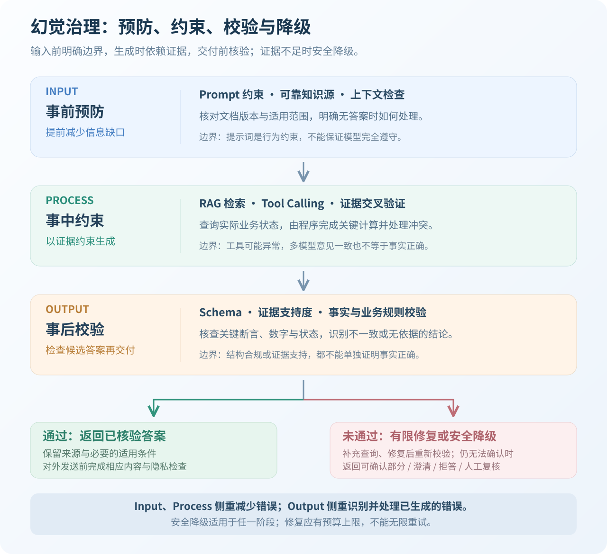
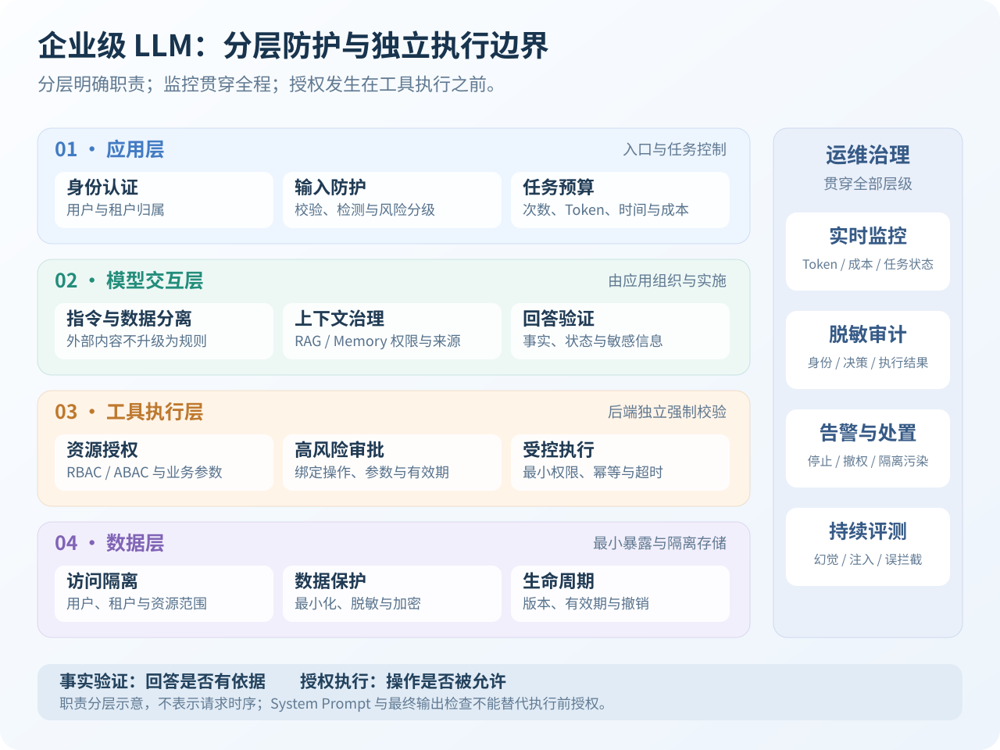
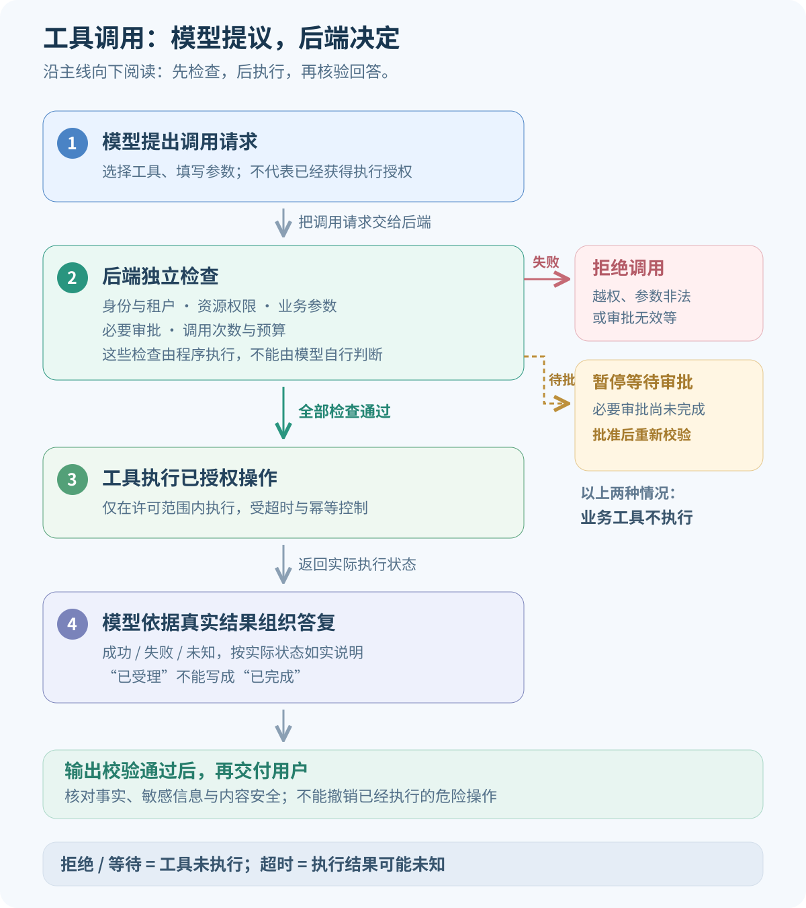

大模型应用需要建立两条独立边界：**事实验证边界决定回答是否有依据，授权执行边界决定操作是否被允许。** 回答流畅不代表事实正确，工具参数合法也不代表调用已经获得授权。<!-- more -->

# 大语言模型幻觉

## 什么是幻觉

**幻觉是指模型生成看似合理但实际错误或虚构的信息。** 这是大语言模型最具挑战性的问题之一，严重影响 AI 应用的可信度。

例如，退款工具返回“申请已受理”，模型却回答“退款已经到账”，便超出了工具结果能够证明的范围。

知识缺失和不确定性本身不是幻觉；把缺少依据的推测当作事实输出，才会产生问题。推理错误与幻觉存在交集，但并非所有推理错误都属于狭义幻觉。

**推理模型也不能彻底消除幻觉。** 更多推理计算可以改善部分复杂任务，却不能补齐不存在的订单数据，也无法保证识别所有错误前提。

## 为什么产生幻觉

幻觉的产生与大语言模型的生成机制及信息边界有关，主要体现在以下五个方面：

1. **概率生成本质**：模型基于上下文和概率分布生成文本，生成过程本身不等于事实验证，语言上合理的内容也可能不符合事实。
2. **训练数据局限**：训练数据可能包含错误、过时或矛盾的信息，模型可能学习并复现这些偏差。
3. **知识截止时间**：模型参数中的知识不会自动更新；未通过有效的检索或工具补充信息时，可能缺少最新知识和实时业务数据。
4. **过度自信倾向**：模型可能在依据不足时，仍生成流畅、确定的回答，将不确定内容表达为事实。
5. **上下文利用不足**：即使正确证据已经进入上下文，模型仍可能遗漏关键条件或混淆冲突信息。长上下文中的信息位置也可能影响回答质量；证据被忽略后，无依据补全会增加幻觉风险。

## 幻觉有哪些表现

以下表现可能重叠；推理错误作为相关可靠性问题一并列出，并非都属于狭义幻觉。

| 类型 | 简洁示例 | 验证方式 |
| --- | --- | --- |
| 事实错误 | 声称当前版本已经支持某项功能 | 核对官方文档和版本 |
| 虚构内容 | 生成不存在的 Java 方法或依赖 | 编译、接口与依赖仓库检查 |
| 推理错误 | 忽略优惠互斥条件计算退款金额 | 代码计算与业务规则校验 |
| 上下文不一致 | 将文档中的退款期限 7 天写成 30 天 | 对照原始材料检查关键条件 |
| 编造执行结果 | 工具超时后回答“操作成功” | 对齐真实执行状态 |
| 虚构引用 | 来源不存在，或内容不支持结论 | 检查来源与断言的对应关系 |

## 检测幻觉的方法

**检测的重点是将回答拆成可核验的事实断言，检查其是否正确、是否得到证据支持，而不是判断表达是否流畅。** 可组合以下方法：

| 方法 | 具体做法 | 能力边界 |
| --- | --- | --- |
| 证据支持度核验 | 将关键断言与给定材料逐项对照 | 证据支持不代表证据本身真实 |
| 外部事实核验 | 使用权威文档、数据库或业务接口验证事实 | 需要确认来源、版本、时效与适用范围 |
| 确定性程序校验 | 用代码核对计算、数值范围、日期及业务状态关系 | 只能覆盖已定义的规则，不能验证所有自然语言事实 |
| 模型辅助评审 | 由评审模型对照证据检查断言，标记疑点和依据 | 评审模型也可能误判，需要抽检或其他校验配合 |
| 多次采样一致性检查 | 比较多次生成中的关键结论，发现冲突 | 仅提供风险信号，一致也可能重复错误 |

**事实正确性与证据支持度不同。** 证据支持度校验检查回答中的关键结论是否得到给定材料支持，但不能证明材料本身真实。真实链接也不代表引用有效，还要检查来源是否支持对应结论。

核验结果可区分为**支持、矛盾、证据不足**。未找到支持证据，不等于已经证明结论错误；应继续核验，或在无法确认时安全降级。

**检测方法本身也需要效果评测。** 使用人工核验的样本与证据，覆盖正常问答、证据不足、资料冲突、过期资料和工具失败等场景，在同一评测集上比较防护前后的表现：

- **回答质量**：检查事实正确性、证据支持度与任务完成情况，同时观察拒答比例，避免把“少回答”误当作“更准确”。
- **检测质量**：检查错误回答的漏检，以及正确回答的误报，并关注延迟与成本。评审模型的评分不能直接当作真实准确率。

评测需明确按整条回答还是单个事实断言统计；高风险结果还应人工复核。

## 减少幻觉的策略

**单一措施无法保证消除幻觉，应组合提示词约束、可信检索、工具调用和输出校验，降低错误输出的风险与业务影响。** 企业级应用应覆盖“事前预防 → 事中约束 → 事后校验”，并在无法确认结果时安全降级。

### 核心方法与适用场景

| 方法 | 核心作用 | 适用场景 | 局限性 |
| --- | --- | --- | --- |
| 提示词约束（Prompt） | 限定回答依据，允许表达不确定性 | 各类问答与生成任务 | 不能保证模型完全遵守 |
| 检索增强生成（RAG） | 检索外部资料，补充缺失或过时的知识 | 企业知识库、产品文档 | 错误、过期或无关资料仍可能引入幻觉 |
| 工具调用（Tool Calling） | 通过权威系统查询实际业务数据 | 订单、库存、物流等实时查询 | 工具也可能延迟、失败或返回错误数据 |
| 证据支持度校验 | 检查回答是否得到给定证据支持 | RAG 问答、资料分析 | 证据支持不等于证据本身正确 |
| 业务规则校验 | 用确定性程序检查计算、范围和状态关系 | 金额计算、业务状态判断 | 需要明确且正确的规则，不能代替资源授权 |
| 输出护栏（Output Guardrails） | 在交付前组合检查结构、事实与内容安全 | 企业级问答与 Agent | 可能误判或漏判，不能识别全部幻觉 |
| 安全降级 | 仅返回可确认部分，或澄清、拒答、转人工 | 证据不足、相互冲突或工具失败 | 可能降低回答覆盖率或增加等待时间 |

**能够通过权威系统查询的事实，应查询后回答；能够通过程序校验的结果，应执行校验，而不只依赖模型自行判断。** 多模型交叉验证可以辅助发现疑点，但结论一致不能作为事实证明。

### 三阶段治理与安全降级

1. **事前预防（Input）**：在提示词中明确依据、禁止事项与无答案处理方式；选择可靠知识源，检查文档版本、适用范围和上下文完整性。
2. **事中约束（Process）**：通过 RAG 和工具补充证据，核对来源、时间与真实业务状态，处理冲突；关键计算交给程序，不以模型估计代替查询结果。
3. **事后校验（Output）**：提取关键断言，检查结构、证据支持和业务规则。JSON Schema 可校验结构、类型及已声明的字段约束；证据支持度校验检查回答是否有依据。**两者都不能单独证明事实正确或操作已获授权。**

校验通过后交付答案；未通过时，在预算内补充检索、查询或修复，并重新校验。仍无法确认时，只返回可靠部分、请求澄清或转人工，必要时拒答，不能靠无限重试生成确定结论。

**Input 与 Process 侧重减少错误产生；Output 侧重识别并处理候选答案中的错误。** 安全降级贯穿三个阶段，任一阶段缺少可靠依据，都不应强行继续。

# 大语言模型安全

## 风险从回答延伸到实际操作

接入 RAG、长期记忆（Memory）和工具后，风险会从内容错误扩展到数据泄露、权限滥用和执行副作用。

| 风险 | 典型表现 |
| --- | --- |
| 提示词注入 / 越狱 | 劫持任务或绕过安全限制 |
| 敏感信息泄露 | 从上下文、日志或外部请求泄露数据 |
| 工具越权与过度自主权 | 工具范围、权限或自主操作能力过大 |
| RAG、Memory 污染 | 恶意内容影响当前或后续会话 |
| 输出处理不当 | 将生成内容直接作为 SQL、命令或 HTML 执行 |
| 供应链与资源风险 | 引入不可信组件，或触发无限循环和高额消耗 |

OWASP LLM Top 10 的 2025 版分别覆盖注入、信息泄露、供应链、数据污染、输出处理、过度代理、系统提示泄露、向量检索弱点、错误信息和无界消耗。治理时应关注具体攻击链，而非仅检查风险名称。

## 提示词注入如何发生

**提示词注入的本质，是把低信任内容中的指令错误地提升为应用行为规则。**

直接注入来自用户输入，例如要求跳过审批或冒充管理员。间接注入隐藏在网页、PDF、邮件、RAG 文档、数据库字段和工具结果中。合法用户只要求总结材料，材料却诱导 Agent 执行数据导出，便是典型的任务劫持。

| 入口或方式 | 示例 | 防守边界 |
| --- | --- | --- |
| 伪造权限 | 文本声称“管理员已批准” | 只认可后端验证的身份与审批 |
| 外部文档 / RAG | 将数据外发伪装成处理步骤 | 来源治理、任务范围与出站限制 |
| 工具返回结果 | 业务字段要求调用敏感工具 | 结果作为数据，不获得指令权限 |
| 多轮对话 / Memory | 将恶意要求保存为长期规则 | 受控写入、来源追踪与撤销 |

攻击可能使用合理的业务措辞，不一定包含“忽略之前指令”。关键词过滤只能提供风险信号，不能独立构成安全边界。

## 提示词注入与越狱的区别

| 维度 | 提示词注入 | 越狱 |
| --- | --- | --- |
| 主要目标 | 劫持应用任务、指令或工具行为 | 绕过模型安全限制 |
| 常见来源 | 用户输入及外部内容 | 攻击者构造的交互内容 |
| 主要后果 | 错误回答、越权操作、信息外泄 | 生成受限制内容，也可能进一步影响工具 |
| 防御重点 | 信任边界、授权执行与数据流控制 | 模型安全能力与应用内容策略 |

提示词注入侧重劫持应用任务或行为，越狱侧重绕过模型安全限制。两者存在重叠，不能简单视为完全相同或互不相关。是否使用工具也不是区分二者的必要条件。

# 企业级分层防护架构

## 设计目标与分层架构

**可靠性关注系统能否持续给出正确、符合任务要求的结果；安全性关注系统能否抵御滥用，保护数据、执行权限和服务可用性。** 两者有交集：错误信息也可能引发安全后果。治理时可以共用检索、工具和审计基础设施，但应分别验证。

这是一张**职责分层图，不是请求执行时序图**。运维治理贯穿全部层级；模型交互层的护栏由应用组织与实施，并不代表模型能够自行保证安全。工具执行层单独列出，用于强调危险操作发生前的后端校验。

## 应用层：认证、入口与任务控制

入口先验证身份、租户归属、请求结构、文件大小和类型，再结合敏感信息与注入检测进行风险分级。用户身份应来自经过验证的认证上下文，不能来自模型参数或未经校验的请求字段。

风险检测结果可以触发限制能力、加强检查或人工复核，**不能因为判定“低风险”就跳过授权**。检测器也可能被绕过，或误拦正常的安全研究与代码分析请求。

网关限流控制请求频率，任务预算控制调用次数、循环、Token、耗时与成本。并行分支应统一预留和扣减预算，避免共同超限。

## 模型交互层：上下文隔离与回答验证

### 可信指令与外部数据分开

使用目标 API 实际支持的消息角色组织应用规则、用户任务和外部材料。字符串中的 `<system>` 或“最高优先级”不会创建真实的高级消息角色，各厂商的角色支持也不能直接互换。

**外部内容即使来自已认证的工具，仍然不能自动成为应用指令。** 对网页进行摘要、将内容存入 Memory，都不会提升其权限。

### RAG 与 Memory 控制

检索前或检索过程中执行用户、租户和资源权限过滤，不能先把越权材料交给模型，再要求模型忽略。相似度和重排分数只辅助判断相关性，不证明内容可信或访问合法。

Memory 应按用户与用途隔离，写入前检查敏感信息、来源和业务有效性，并保留有效期与撤销关联。原始来源被删除或失效时，应能够定位相关派生记忆，避免污染长期保留。

### 输出校验的接入位置

将前述“事后校验”部署在候选回答生成后、向用户交付前。本层还需检查有害或违规内容、敏感信息与渲染安全，防止危险 HTML、链接或图片形成外泄通道。**事实核验、内容审核和隐私检查各有职责，不能相互替代。**

**流式输出一旦发送，无法可靠撤回。** 敏感信息和关键业务结论应先检查再释放，进度通知不能提前宣告业务成功。

## 工具执行层：先校验，再执行

**模型生成的是调用请求，后端校验通过后，工具才可以访问数据或修改业务状态。** 权限检查由程序执行，不能依赖模型判断自己是否有权限。

### 执行前，后端检查什么

| 检查项 | 具体判断 |
| --- | --- |
| 工具是否允许使用 | 只接受已经注册、启用且在当前任务范围内的工具 |
| 调用者身份是否可信 | 从认证上下文获取用户和租户，不采信模型自行填写的身份 |
| 是否有资源访问权限 | 当前用户能否对目标数据执行这项操作 |
| 参数是否符合规则 | 检查类型、取值范围，以及业务状态是否允许操作 |
| 是否需要人工审批 | 删除、批量修改、对外发送等高风险操作，按策略执行前审批 |
| 是否超过任务限制 | 检查调用次数、总耗时和预算，防止无限循环或资源滥用 |

资源权限可通过 RBAC 按角色分配，也可通过 ABAC 结合主体、资源与环境属性判断。**认证确认“是谁”，授权判断“能做什么”，审批确认“是否同意这次高风险操作”。** 用户已经登录或完成审批，都不代表可以跳过权限检查。

### 检查通过后，怎样限制执行范围

- **只授予必要权限**：工具仅能访问任务所需的数据、文件和网络；只读工具也需要鉴权，因为读取同样可能泄露敏感信息。
- **审批对应真实操作**：展示实际对象和参数，审批记录绑定执行主体、目标资源、参数及有效期。参数改变后重新审批，执行前重新检查权限和业务状态，并防止审批凭据重复使用。
- **限制具体能力**：外部 URL 不得访问未授权地址，文件读写限定在允许目录，数据库仅开放必要操作并采用参数化查询。
- **控制重复与故障影响**：设置超时、限流和熔断；修改数据的操作通过幂等控制避免重复执行，并记录实际执行结果。

**使用 REST 或 MCP 接入工具，都不能省略业务鉴权。** 工具网关与下游服务应分别检查当前调用的权限，不能因为请求来自 Agent 就自动放行。

### 检查未通过或执行结果不确定时怎么办

身份、权限或参数检查失败时，拒绝调用；需要审批但尚未完成时，暂停等待，不能提前执行。未注册工具、缺失授权或审批验证异常时，应默认拒绝。

工具返回失败时如实回填失败信息；超时时，结果可能未知，**不能直接认定操作未发生，也不能向用户宣告成功**。应先查询实际状态，或通过支持幂等的机制恢复，避免盲目重试。

最后将实际结果交回模型组织答复，再进行输出校验。**执行前检查决定操作能否发生，执行后检查决定结果如何交付。**

## 数据层：最小暴露与隔离存储

敏感数据应按业务用途最小化读取和返回，在发送模型、工具外发及用户交付前按需脱敏。凭据由执行组件受控使用，不应进入 Prompt 或普通日志。

数据存储需要租户与用户隔离、访问控制、传输和存储加密，以及版本、有效期和删除机制。**加密保护数据传输与存储，不能阻止已获解密权限的应用错误外发数据。**

## 运维治理层：监控、审计与恢复

通过 TraceId、SessionId、任务 ID 和 ToolCallId 关联检索、模型、工具及输出事件，记录策略命中、审批关联、真实结果、Token、成本和异常终止。

日志优先保留必要元数据、证据标识和参数摘要，原文留存需另行实施脱敏、权限和保留期限控制。发现异常后，应能够停止任务、撤销权限、禁用工具，以及隔离受污染的文档和记忆。

# 总结

**大模型应用需要同时治理可靠性和安全性。** 幻觉属于可靠性问题，表现为生成错误、虚构或缺乏依据的结论；提示词注入侧重劫持应用行为，越狱侧重绕过模型安全限制。回答是否正确、操作是否被允许，应分别验证。

**幻觉治理应覆盖事前预防、事中约束和事后校验，并配套安全降级。** 知识不足时使用可信 RAG 和权威工具补充依据；复杂推理通过任务分解与业务代码校验中间结果；交付前逐项核查关键断言。证据不足时澄清或拒答，多模型意见一致也不能代替事实证明。

**防御提示词注入的核心是建立指令信任边界，采用多层安全防护，不能仅依赖 System Prompt。** 分隔符有助于区分指令和数据，但不构成强制安全隔离；外部内容不能自行升级为应用规则。模型只能提出工具请求，后端通过资源授权、参数校验、最小权限和必要审批决定是否执行。

**企业落地还需独立实施内容审核、隐私保护与审计。** 敏感信息在进入模型、写入记忆和对外交付前按需最小化与脱敏；高风险结论和操作采用相应人工复核。内容审核不能代替事实核验，最终输出检查也不能撤销已执行的危险操作。
